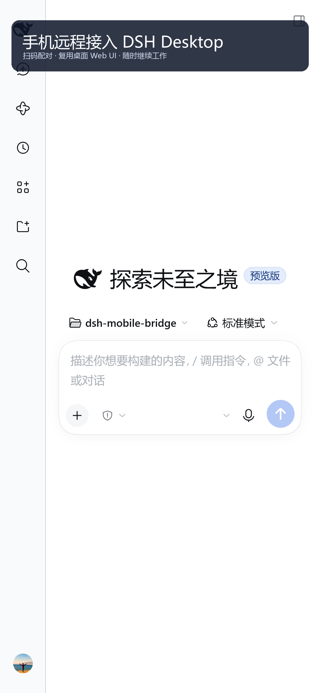

# DSH Mobile Bridge

  

> Use your phone's browser to securely reach your local **DSH Desktop** — scan a QR to pair, reuse the exact same web UI.
>
> English | [中文](./README.md)

  

DSH Desktop's web UI only listens on `127.0.0.1`, so phones can't reach it. This plugin adds an **edge gateway** in between: your phone still loads the desktop's web UI (same-origin WebSocket / RPC, streaming output all untouched), so there is no "crippled mobile version" and no second frontend to maintain.

## Highlights

- **QR pairing, long-lived sessions** — the desktop shows a 6-digit one-time code / QR; after pairing, your phone holds an HttpOnly device token and just works. Optional desktop confirmation adds a "human at the keyboard" check.
- **Full desktop UI on mobile** — sessions, streaming output, stop, model & reasoning level, plugins, file preview, terminal: all identical to desktop. Narrow-screen tweaks: overlay sidebar, auto-collapse, no auto keyboard, touch-always-visible controls, PWA "add to home screen".
- **Tool approvals on your phone** — when the agent needs a tool approval, a card pops up on your phone: *once / always / reject*. "Always" is remembered per tool + argument fingerprint. Fail-closed: timeouts and offline phones count as "not executed".
- **Four access lanes** — LAN direct, cloudflared quick tunnel (zero account), Tailscale (private, WireGuard-encrypted; one-click wizard incl. Serve/Funnel), Cloudflare named tunnel (your own fixed domain, two-click setup in the settings panel).
- **Always-on fixed address** — register the named tunnel as a Windows service so it survives reboots; a tunnel health watchdog auto-restarts dead tunnels with exponential backoff.
- **Device management** — list paired phones (online/offline), revoke one / all, purge history; each phone gets its own token (default max 5).

## Quick start

1. Install as a DSH Desktop bundle: `plugin_manager action=install_bundle target=<this directory>`, then restart Desktop. A cloudflared quick tunnel starts automatically — you are usable out of the box.
2. Desktop: **Settings → Phone Bridge → Generate pairing code**.
3. Phone: scan the QR (or type the 6-digit code). Done — bookmark it or add to home screen.

> The quick tunnel URL is random and changes on restart. For a stable address use Tailscale (private) or your own free domain + Cloudflare named tunnel — the full zero-cost walkthrough (DigitalPlat free domain → Cloudflare → named tunnel → Windows service) is in the [Chinese README §6](./README.md#六固定地址--稳定入口解决重启后-cloudflare-报错旧截图失效).

## Security model

A paired browser has **owner-level power** over the machine. Exposing this to the internet ≈ giving yourself a remote shell; only pair your own devices. Defense in depth: device-token gate → one-time pairing code (TTL / attempt limits / per-IP rate limit) → optional desktop confirmation → fail-closed approvals. Tunnel tokens stay in a local `0600` file, never committed.

## Configuration

All options (`edgeHost`, `edgePort`, `tunnelEnabled`, `tunnelMode: quick|token`, `maxDevices`, `approvalTimeoutMs`, `alwaysScope`, …) are documented in the [Chinese README](./README.md#4-配置项). One dependency: `qrcode`. Requires Node ≥ 22 and DSH Desktop.

## Feedback

- 🐛 Bugs & feature requests: [Issues](https://github.com/msz-legend/dsh-mobile-bridge/issues)
- 💬 Discussions: [Discussions](https://github.com/msz-legend/dsh-mobile-bridge/discussions)

## License

MIT. If this project helps you, a ⭐ is the best encouragement.
