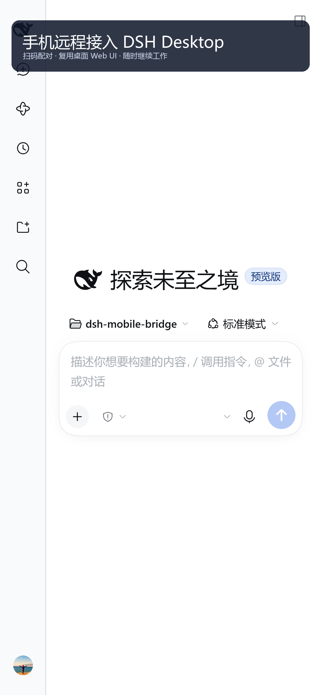
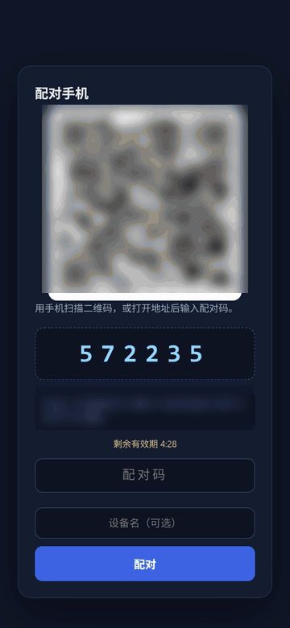
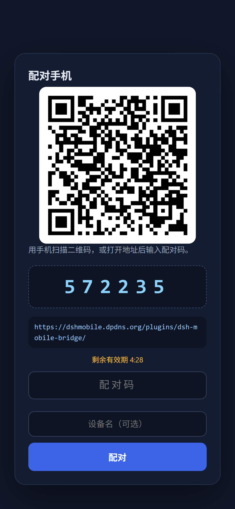
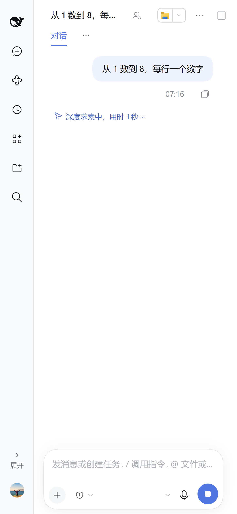
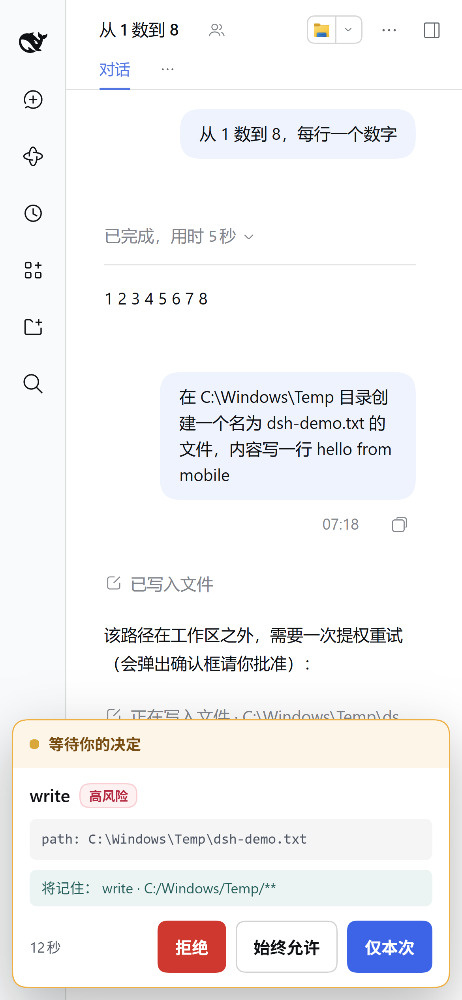
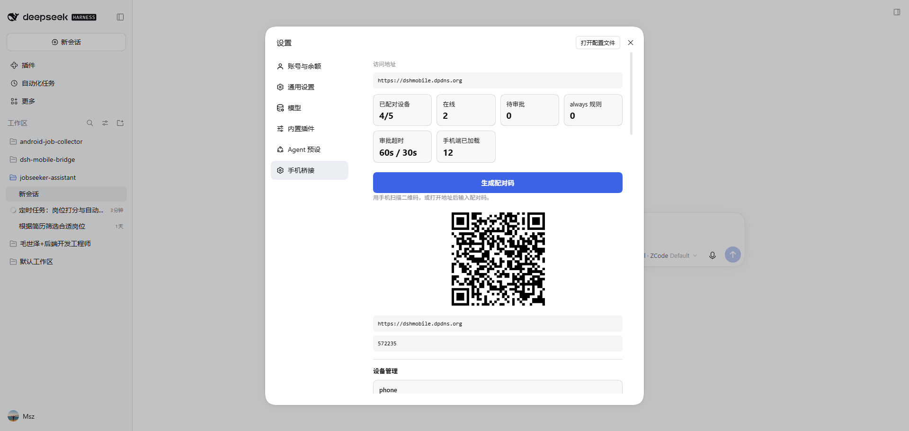
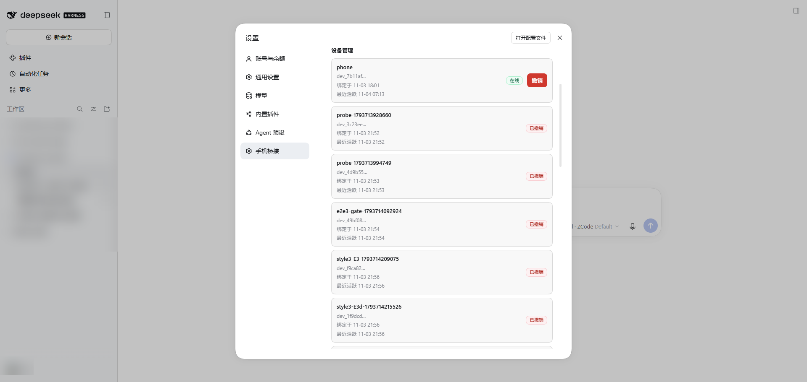
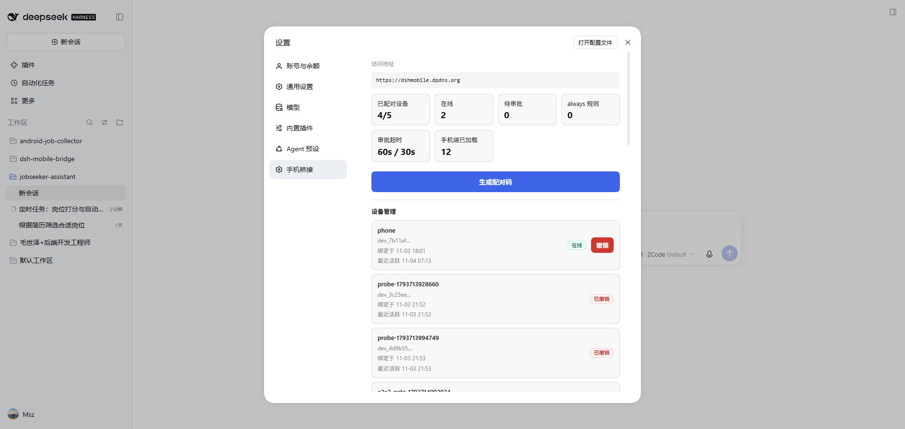
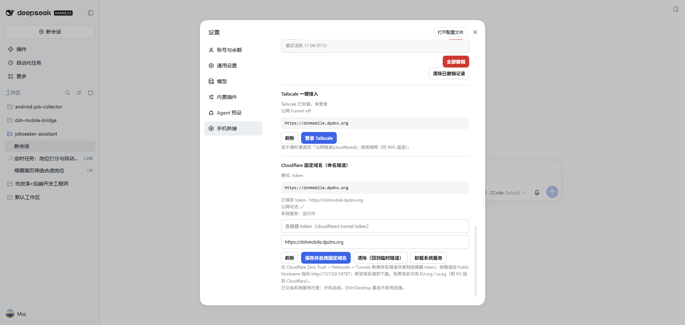

# DSH Mobile Bridge

<p align="center">
  
</p>

> 用手机浏览器安全接入本机 **DSH Desktop** —— 扫码即用，复用桌面同一套 Web UI。
>
> [English](./README.en.md) | 中文

<p align="center">
  
  &nbsp;&nbsp;
  
</p>

<p align="center">
  <sub><b>手机端</b>（复用桌面同一套 Web UI）</sub><br/>
  
  
  
</p>

<p align="center">
  <sub><b>桌面端</b>（配对 · 设备管理 · 固定域名接入）</sub><br/>
  
  
  <br/>
  
  
</p>

<p align="center"><sub>更多截图见 <a href="docs/screenshots/">docs/screenshots/</a>（13 张）</sub></p>

<p align="center">
  <a href="LICENSE"></a>
  
  <a href="https://github.com/msz-legend/dsh-mobile-bridge/stargazers"></a>
</p>

**30 秒跑通**：把本目录作为 bundle 装进 DSH Desktop（`plugin_manager action=install_bundle target=<本目录绝对路径>`）→ 重启 Desktop 自动拉起临时隧道 → 桌面「设置 → 手机桥接」生成配对码 → 手机扫码即用。想要「重启后地址不变」的固定入口，见 [§6 固定地址](#六固定地址--稳定入口解决重启后-cloudflare-报错旧截图失效)。

DSH Desktop 的 Web 界面只监听 `127.0.0.1`，手机无法直接访问。本插件在两者之间加一道**边缘网关（edge）**：
手机通过它加载的仍然是桌面上那份 Web UI（同源 WebSocket、同源 RPC、流式输出全部原样复用），
因此不会出现「移动端功能残缺」的问题，也不需要维护第二套前端。

---

## 一、功能特性

### 接入与配对
- **扫码配对、长期免登录**：桌面生成 6 位一次性配对码 / 二维码，手机扫码后获得长期设备令牌（HttpOnly Cookie），之后打开即用。
- **可选桌面确认**：手机来源的配对默认需要桌面点一次「允许」（多一层「人在电脑前」保障）；可开 `autoApprovePairing` 免确认。
- **多档外网接入**：cloudflared 临时隧道（零账号）、Tailscale（仅自己设备可见）、局域网直连，按需切换。
- **零配置反代**：网关自动改写 `Host` / `Origin` 为 loopback，无需修改 DSH 源码或信任配置。

### 会话与审批
- **完整复用桌面 UI**：会话列表、新建会话、发送、流式输出、停止输出、模型/推理等级、插件、文件预览、终端等全部与桌面一致。
- **工具审批搬到手机**：宿主发起工具审批时，手机弹出审批卡片，可选 **仅本次 / 始终允许 / 拒绝**；「始终允许」按工具名 + 参数指纹记忆。
- **失败关闭（fail-closed）**：审批超时、手机离线且为远程会话时一律判为未执行，安全默认。

### 设备管理（桌面端）
- 设置 →「手机桥接」→「设备管理」：列出所有已绑定设备（名称、在线/离线、绑定时间、最近活跃）。
- 支持逐台「撤销」、一键「全部撤销」、「清除已撤销记录」；撤销即时生效，已连接手机立刻断开、令牌作废。
- 命令行/脚本同样可用（均仅本机 loopback 可调），见下文「设备管理」。
- 每台手机一个独立令牌，默认最多 5 台。

### 移动端体验优化（窄屏）
- **侧栏浮层**：窄屏展开左侧功能栏时改为覆盖层 + 灰色遮罩，主内容不被挤扁。
- **点会话自动收起侧栏**：点某个会话进入对话后，侧栏自动收起，直接看到会话全景。
- **点灰色遮罩收起侧栏**：展开态点右侧灰色区域即收起侧栏（不会误触被遮住的会话）。
- **空白区快捷展开**：收起态图标栏的空白区域可直接点击展开，并在左下角头像上方显示「› 展开」提示。
- **打开会话不自动弹输入法**：点开会话时不自动聚焦输入框，避免软键盘遮挡；用户点输入框才唤起键盘。
- **提问卡片自适应**：宿主的「提问卡片」在窄屏下铺满屏宽、文字自动换行、按钮完整可点。
- **触屏常显**：桌面端 hover 才出现的控件（复制、关闭标签等）在触屏上常显；支持「添加到主屏幕」全屏运行。

### 稳定性与固定地址
- **隧道健康看护**：周期探测公网地址，cloudflared 进程活着但隧道已死（如边缘 1033）时，连续失败自动重启（叠加指数退避）。
- **Tailscale 一键接入向导**：设置 →「手机桥接」里自动检测 Tailscale 状态，可一键登录、一键开启公网 Funnel、一键把 `https://<机器>.<tailnet>.ts.net` 设为固定地址并生成永久二维码；连不通时提示回退 cloudflared/局域网（仅桌面 loopback 可操作）。
- **Cloudflare 固定域名一键接入**：设置里填入 Cloudflare 命名隧道的连接器 token + 固定域名，即可写入本地 `tunnel.json`、切到命名隧道并重启（token 只存本地 0600 文件，不进仓库）；一键清除可回到临时隧道。适合「无 Cloudflare 账号之外的免费域名（如 EU.org/us.kg）→ Cloudflare → 命名隧道」实现永久固定公网地址。
- **Cloudflare 系统服务（开机常驻）**：在固定域名卡片里一键执行 `cloudflared service install <token>`（需管理员权限），把命名隧道交给 Windows 服务托管——**开机自启、与 DSH/Desktop 重启无关**；插件侧自动停止自管 cloudflared 并保持 `publicBase` 固定（`tunnel.json` 的 `serviceManaged` 标记重启后依旧生效）。失败时自动回退为插件托管 token 隧道，不会断线。
- **固定地址**：可把对外地址固定为一个稳定入口（Tailscale 私网 IP、Tailscale Serve/Funnel、Cloudflare 命名隧道），
  从而**重启后地址不变、保存的配对二维码/截图长期可用**，不再出现「刷新看到 Cloudflare 报错」。

### 开箱即用 vs 固定地址（BYO 域名）
- **开箱即用（零配置）**：从 GitHub 安装后，插件自动拉起 Cloudflare quick 临时隧道，立即可用；局域网、配对码/二维码、设备管理、工具审批等全部开箱即用。临时隧道的地址随机、重启会变——适合先跑起来。
- **固定地址需各人自带（BYO）**：形如 `https://dsh.你的域名` 的永久入口，绑定的是**你自己的 Cloudflare 账号 + 你申请的域名 + 你本机的隧道 token**（token 只存本地 `tunnel.json`，不进仓库），无法由他人代为配置，也不应共享凭据。
- **拿到自己的固定地址**：走免费域名（[EU.org](https://nic.eu.org) / [us.kg（DigitalPlat FreeDomain）](https://dash.domain.digitalplat.org/)）+ 免费 Cloudflare + 命名隧道，在设置页「保存并启用 + 注册为系统服务」两键即可，人人自助，无需改动仓库。

---

## 二、快速开始

### 1. 安装插件
把本目录作为 bundle 安装到 DSH Desktop（插件为本地目录，装好后在 DSH 插件列表里可见并激活）：

```
plugin_manager action=install_bundle target=<本目录绝对路径>
```

或手工写进 profile 的 `dependencies`（`link:<本目录>`）与 `dsh.profile.bundles`，然后重启 Desktop。
依赖仅一个：`qrcode`（生成配对二维码，缺失时降级为「地址 + 配对码」文本）。

### 2. 选择访问通道

| 通道 | 适用场景 | 做法 |
|---|---|---|
| **Tailscale 私网（推荐，固定地址）** | 只有自己的设备访问，地址固定 | 两端登录同一 tailnet；edge 自动绑定 Tailscale 网卡；`publicBase` 设为本机 Tailscale IP（见 §6.A） |
| **cloudflared 临时隧道** | 手机不在同一网络、零账号 | `winget install Cloudflare.cloudflared`，配置 `tunnelEnabled: true`（quick），重启后自动得到 `https://<random>.trycloudflare.com` |
| **局域网直连** | 手机与电脑同网段 | 手机访问 `http://<本机LAN IP>:8787`（`edgeHost` 设 `auto` 或 LAN IP） |
| **Cloudflare 命名隧道** | 有账号+域名的公网固定域名 | `tunnelMode: token` + 本地 `tunnel.json` 填 token 与域名（见 §6.C） |

`publicBase` 取值优先级：显式配置（含本地 `tunnel.json`） → cloudflared quick 隧道 → Tailscale DNS → LAN → loopback。

### 3. 配对
1. 桌面打开 **设置 → 手机桥接**，点「生成配对码」，得到 6 位码与二维码（5 分钟有效）。
2. 手机扫码或输入配对码。
3. 配对成功后手机自动进入 Web UI，之后打开同一地址即可直接使用。

配对码限制：5 分钟一次性、同码最多 3 次尝试、按访客 IP 限速、默认最多 5 台设备。

> **免确认模式**：配置 `autoApprovePairing: true` 时，配对码校验通过后直接发放设备令牌，桌面不再弹确认卡片（配对码的时效与限次防护仍然生效）。

### 4. 配置项

```yaml
- id: dsh-mobile-bridge
  name: 'dsh-mobile-bridge'
  config:
    enabled: true
    edgeHost: '127.0.0.1'   # 边缘网关监听地址；'auto' 自动选 LAN+loopback；会额外自动绑定 Tailscale 网卡
    edgePort: 8787
    publicBase: ''          # 对外地址；留空自动探测（也可写到本地 tunnel.json）
    tunnelEnabled: true     # 是否启用 cloudflared 隧道（quick/token）
    tunnelMode: 'quick'     # quick=临时地址；token=命名隧道固定域名
    tunnelToken: ''         # 命名隧道 token（敏感，建议放本地 tunnel.json，勿提交）
    tunnelBin: 'cloudflared'
    tunnelProtocol: ''      # 留空自选；WARP 环境建议 'http2'
    enableLan: true
    autoApprovePairing: false
    maxDevices: 5
    pairingTtlMs: 300000
    pairingMaxAttempts: 3
    pairConfirmTtlMs: 120000
    approvalTimeoutMs: 60000
    approvalTimeoutRemoteMs: 30000
    offlineGraceMs: 5000
    alwaysScope: 'session'  # session | global
    storeDir: ''            # 设备与规则落盘目录，默认 ~/.dsh/dsh-mobile-bridge
```

---

## 三、使用方式（手机端）

- **打开**：扫码/输入配对码后进入，之后打开收藏地址或「主屏幕图标」即可。
- **左侧功能栏**：窄屏下收起为图标栏。要展开，点左下角头像上方的「› 展开」，或直接点图标栏的**空白区域**，或点顶部开关。展开后点右侧灰色遮罩、或点任意会话，都会自动收起。
- **打开会话**：点会话即进入对话；此时**不会自动弹出输入法**，点输入框才开始输入。
- **发送 / 停止**：输入框发送消息，流式中发送键变红色停止键；支持 `@` 引用文件/对话、`/` 调用指令。
- **工具审批**：agent 需要工具授权时弹出卡片，选「仅本次 / 始终允许 / 拒绝」即可，选择会回传宿主继续执行。
- **设置**：「设置 → 手机桥接」查看访问地址、在线/待审批、设备管理、生成配对码、公网隧道状态；桌面端可做撤销等敏感操作，手机端只读提示。
- **添加到主屏幕**：浏览器菜单里选「添加到主屏幕」，可全屏独立运行。

---

## 四、设备管理

桌面端 **设置 → 手机桥接 → 设备管理** 可直接操作（推荐）。命令行/脚本等价端点（仅本机 loopback 可调，手机经 edge 访问一律 403）：

```sh
# 查看已绑定设备与在线状态
curl http://127.0.0.1:<端口>/plugins/dsh-mobile-bridge/devices.json

# 撤销某台设备（立即生效，已连接会断开）
curl -X POST -H 'content-type: application/json' -d '{"deviceId":"dev_xxx"}' \
  http://127.0.0.1:<端口>/plugins/dsh-mobile-bridge/devices/revoke

# 撤销全部设备
curl -X POST http://127.0.0.1:<端口>/plugins/dsh-mobile-bridge/devices/revoke-all

# 清除已撤销的历史记录
curl -X POST http://127.0.0.1:<端口>/plugins/dsh-mobile-bridge/devices/purge
```

---

## 五、安全说明

- 经设备令牌进入的浏览器与桌面同属 **owner** 权限；**把通道暴露到公网≈owner 级远程操作能力**，务必只让自己配对。
- 防线依次为：**设备令牌闸门**（未配对请求不转发宿主）→ **一次性配对码**（桌面可见、限次作废）→ **可选桌面确认** → **按真实访客 IP 限速熔断**。真正的边界是设备令牌。
- **Tailscale 私网档**：手机与电脑同在 WireGuard 加密的 tailnet 内，链路加密、仅自己设备可达（无需公网暴露，最安全）。
- **cloudflared / 命名隧道**：公网段全程 TLS。敏感 token 只放本地 `tunnel.json`（0600），**不要提交到 git**。
- 局域网 HTTP 档 cookie 在途不加密；所有响应附加 `nosniff` / `no-referrer` / `SAMEORIGIN` 等安全头。

---

## 六、固定地址 / 稳定入口（解决「重启后 Cloudflare 报错、旧截图失效」）

quick 隧道地址是随机的 `https://<random>.trycloudflare.com`，**每次重启都会变**：手机旧地址会指向已失效隧道 → 刷新看到 Cloudflare 1033/530「连不上」，旧二维码/截图也失效。要「地址固定、截图长期可扫」，需固定入口。以下按有无账号选择：

### A. Tailscale 私网直连（推荐，免费，无需 Cloudflare）
电脑安装并登录 Tailscale（`winget install Tailscale.Tailscale` → `tailscale up`）。插件会自动把 **Tailscale 网卡地址**也纳入 edge 监听，于是同一 tailnet 内的手机可直连一个固定地址（WireGuard 加密）。
把固定地址写进本地 `~/.dsh/dsh-mobile-bridge/tunnel.json`（不进仓库）：

```json
{ "publicBase": "http://<本机Tailscale IP>:8787" }
```

手机安装 Tailscale 并登录同一账号后，用该固定地址打开即可（首次仍需桌面签发配对码）。地址固定 → 截图/书签长期可用。

### B. Tailscale Serve / Funnel（需要你在 tailnet 里一次性「启用 HTTPS/Serve」）
- 仅自己设备：`tailscale serve --bg 8787` → `https://<机器>.<tailnet>.ts.net`。
- 公网、手机免装 App：`tailscale funnel --bg 8787`（首次按提示在 Tailscale 后台开启 Funnel）。
开启后把 `publicBase` 设为对应 `https://….ts.net` 即可。

### C. Cloudflare 命名隧道（有 Cloudflare 账号 + 域名时）
1. Zero Trust → Networks → Tunnels → 新建（cloudflared），复制**连接器 token**；添加 Public Hostname：`dsh.example.com → http://127.0.0.1:8787`。
2. 本地 `~/.dsh/dsh-mobile-bridge/tunnel.json`（0600）：
   ```json
   { "token": "<连接器 token>", "publicBase": "https://dsh.example.com" }
   ```
3. 配置 `tunnelEnabled: true`、`tunnelMode: 'token'`（`tunnelToken`/`publicBase` 留空会自动读取该文件），重启 Desktop。

> 稳定性：插件对 quick 隧道做**健康探测**——进程活着但隧道已死时连续失败 3 次自动重启 cloudflared（叠加指数退避），减少掉线。
> 固定地址让「截图长期可扫」，但**首次接入新设备仍需桌面签发配对码**；已配对设备靠设备 Cookie 持续在线。

### D. 完整实战：0 元拿到永久固定域名 + 开机常驻（实测记录）

下面是 **2026-11 实测跑通**的完整路径，全程免费（域名 + Cloudflare + 隧道 + 系统服务均 0 元），最终得到形如 `https://dshmobile.dpdns.org` 的永久地址，Windows 服务托管隧道、开机自启、与 DSH/Desktop 重启完全解耦。

**① 申请免费域名（DigitalPlat，约 10 分钟）**
1. 打开 `https://dash.digitalplat.org/` 用邮箱注册，完成**账户验证**（要求 GitHub OAuth，防滥用）。
2. 域名注册 → DigitalPlat Domains：填前缀（如 `dshmobile`）+ 后缀 → 勾条款 → 检查可用性 → 选「**稍后配置**」（先注册、NS 之后改）→ 注册。
3. ⚠️ **`.us.kg` 目前暂停向免费账户开放**（提示需订阅计划）；免费可用后缀有 `.dpdns.org` / `.xx.kg` / `.qzz.io` / `.qd.je`，效果等同。免费名额每账户 1 个，域名「正常 · 永久」。

**② 注册 Cloudflare 并添加站点（免费）**
1. `https://dash.cloudflare.com/sign-up` 注册（可用 GitHub 登录，免邮箱验证）。
2. 添加站点（Add a site）→ 输入第①步的域名 → 选 **Free** 计划 → DNS 记录扫描为 0 条属正常，直接「继续激活」→ 记下分配的 **2 个 NS**（形如 `xxx.ns.cloudflare.com` / `yyy.ns.cloudflare.com`）。

**③ 回 DigitalPlat 把 NS 改成 Cloudflare 的**
- 域名详情 → DNS → **域名服务器** → NS1/NS2 填入两个 Cloudflare NS（顺序无关）→ 更名称服务器。
- 回 Cloudflare 等站点变 **Active**（实测几分钟）。可用 `Resolve-DnsName <你的域名> -Type NS` 验证全球生效。

**④ 建命名隧道 + Public Hostname**
1. Cloudflare 控制台 → **Zero Trust → Networking → Tunnels → Create Tunnel**，命名（如 `dsh-home`）→ **复制安装命令里的连接器 token**（`eyJ…` 那串；此页不必执行安装）。
2. 隧道详情 → **Add route → Published application**：Subdomain 留空（用主域）+ Domain 选你的域名 + Service 填 `http://127.0.0.1:8787`（**8787 是插件 edge 端口**，以 `/status` 返回的 `edge.port` 为准；别填桌面 Web 端口）。

**⑤ 插件「两键」接入**
1. DSH 设置 → 手机桥接 →「Cloudflare 固定域名」卡片：粘贴 token + `https://<你的域名>` → **保存并启用**（先由插件托管跑起来，立即可用）。
2. 点 **「注册为系统服务（开机常驻）」**：需要管理员权限——插件会触发 UAC/或返回 `needs-admin` 并**自动回退为插件托管**（不断线）。也可手动在管理员 PowerShell 执行
   `& "C:\Program Files (x86)\cloudflared\cloudflared.exe" service install <token>`，
   成功后给本地 `tunnel.json` 加上 `"serviceManaged": true` 并重启插件。
3. 成功标志：卡片显示「系统服务：运行中」；`GET /plugins/dsh-mobile-bridge/cloudflare.json` 返回 `serviceManaged/serviceInstalled/serviceRunning: true`；系统里只剩**服务那 1 个** cloudflared 进程（插件不再自启）。

**⑥ 验证与配对**
- 任意网络执行 `curl https://<你的域名>/status` 返回 401「pair this device first」＝全链路已通。
- 手机**关 WiFi 走流量**，扫桌面二维码配对一次即永久有效；之后电脑/DSH 重启、甚至重启整机，手机地址都不变。

> 坑位速查：Public Hostname 的 Service 端口必须是 **8787**（edge 端口）；token 只存本地 `tunnel.json`（0600，不进仓库）；卸载系统服务会自动回退为插件托管；免费域名删除后名额会释放，可重新注册。

---

## 七、常见问题（FAQ）

- **重启后手机显示 Cloudflare 报错**：quick 隧道地址变了。改用固定入口（§6：Tailscale 私网 IP / Serve/Funnel / 命名隧道）。
- **保存的二维码/截图以后扫不开**：旧二维码里含已失效的临时地址。使用固定入口后，把 `publicBase` 固定下来，重新生成一次二维码长期保存。
- **手机连不上（Tailscale 私网）**：确认两端 Tailscale 均在线、登录同一 tailnet；`tailscale status` 能看到本机；必要时重启 Desktop 让 edge 重新绑定 Tailscale 网卡。
- **页面整体偏小/挤压（华为等）**：浏览器若开了「桌面版网站」会按 980px 缩放，建议对该站点**关闭桌面版网站**，使用标准移动布局。
- **不想公网暴露**：用 Tailscale 私网直连（§6.A）或 `tailscale serve`（§6.B，仅自己设备），不要用 Funnel/命名隧道。
- **如何解绑某台手机**：设置 → 手机桥接 → 设备管理 → 撤销；或调用 `devices/revoke`。

---

## 七、审批通知（外部推送通道）

审批卡片出现时（以及新设备请求配对时），本机会把消息**推送到你配置的外部通道**——不依赖浏览器，任何手机装个对应 APP 就能收，锁屏可见、点击直达。

> 为什么不用浏览器通知：Android WebView 系浏览器（夸克/UC/百度/微信内置）与 iOS 第三方浏览器根本不支持 Web 通知/推送；各家权限模型也不一致。统一走外部通道反而最省心、覆盖最广。

### 7.1 配置入口

**电脑端**：DSH Desktop → 设置 → 手机桥接 → **外部推送通道** → 添加通道 → 选类型 → 按面板里的步骤操作 → 保存。
**手机端**：无需配置（它只负责显示审批卡片与决策）。

面板里每种通道都带**分步配置说明**，这里再给出各通道的要点与官方链接：

| 通道 | 适用 | 配置要点 | 官方地址 |
|---|---|---|---|
| **ntfy** | Android / iOS，推荐 | 装 APP → 订阅主题（如 `dsh-approval`）→ 面板填同名主题，服务器留空 | <https://ntfy.sh> · <https://docs.ntfy.sh> |
| **Bark** | iOS | 装 Bark → 复制 APP 顶部的 `https://api.day.app/xxxx` → 粘贴到面板 | <https://bark.day.app> |
| **企业微信·自建应用** | **微信**（官方 API） | work.weixin.qq.com 注册（个人可）→ 创建应用拿 AgentId/Secret → 「我的企业」拿 corpId → 「微信插件」扫码关注（消息直达微信服务通知）→ 三项填面板 | <https://developer.work.weixin.qq.com> |
| **企业微信·群机器人** | 企业微信群 | 群设置 → 群机器人 → 添加 → 复制 Webhook（`qyapi.weixin.qq.com/.../send?key=…`）→ 填到面板 | <https://developer.work.weixin.qq.com> |
| **飞书** | 群机器人 | 群设置 → 群机器人 → 自定义机器人 → 安全设置勾「自定义关键词」填 `审批` → 复制 Webhook → 填到面板 | <https://open.feishu.cn> |
| **钉钉** | 群机器人 | 群设置 → 智能群助手 → 添加机器人（自定义）→ 安全设置选「自定义关键词」填 `审批` → 复制 Webhook → 填到面板 | <https://open.dingtalk.com> |
| **Telegram** | Bot | @BotFather 建 bot 拿 Token → 给 bot 发条消息 → `getUpdates` 拿 `chat.id` → 填面板 | <https://core.telegram.org/bots> |
| **通用 Webhook** | 任意 | 填可公网访问的 POST 接口；本机将 POST `{ "title", "body", "url" }` JSON，可选 Bearer Token | — |

> **想在微信里收？** 唯一官方途径就是「企业微信自建应用 + 微信插件」：个人微信扫码即可注册企业微信（无需企业认证），创建自建应用后，在管理后台「我的企业 → 微信插件」用微信扫码关注，之后应用消息会直接出现在**微信的服务通知**里。Server酱等第三方推送因属于非官方通道、且免费额度有限，已不内置。

保存后通道立即生效；面板里点「刷新」可改配置、点「删除」停用。

### 7.2 消息内容

- **审批**：标题「工具审批」，正文「有工具调用等待你的审批：<工具名>」，附桥接页链接。
- **配对**：标题「配对请求」，正文「设备「<设备名>」请求接入」，附链接。
- 点击通知里的链接（或从 APP 打开）即可直达桥接页处理。

### 7.3 限制与注意

- 外部通道由**本机**发起 HTTP 请求，需要能访问对应服务（ntfy.sh / qyapi.weixin.qq.com / 各群机器人域名）。
- 企业微信自建应用的 access_token 由本机缓存（约 2 小时，失效自动重取）；Secret 只保存在本机 `push.json`（0600）。
- 通道配置存在本机 `~/.dsh/dsh-mobile-bridge/push.json`（权限 0600），不随配对迁移。

---

## 八、目录结构

```
index.js               Host 入口（装配与生命周期、配置归一、隧道看护接线）
client.js              浏览器半身（审批卡、设置面板/设备管理、移动端样式与交互补丁）
lib/edge.js            边缘网关（多地址监听含 Tailscale、反代 / WebSocket 透传 / 令牌闸门 / 限速）
lib/approval-bridge.js 审批桥接（宿主审批 → 手机卡片 → 决策回传，fail-closed）
lib/pairing.js         配对码与设备令牌（含撤销 / 清理）
lib/routes.js          配对页 / 事件流 / 决策 / 设备管理 / 状态路由
lib/host-login.js      宿主登录交换与 cookie 续期
lib/cloudflared.js     隧道管理（quick / token、自动重启、健康探测）
lib/tunnel.js          对外地址探测（含 Tailscale / LAN）
lib/events.js          设备在线状态 + SSE 推送总线
lib/push.js            外部推送通道（ntfy/Bark/企业微信自建应用/企业微信·飞书/钉钉群机器人/Telegram/通用 webhook）
lib/index-inject.js    移动端注入（viewport / polyfill / PWA）
```

## 反馈与社区

- 🐛 Bug / 功能建议：[Issues](https://github.com/msz-legend/dsh-mobile-bridge/issues)
- 💬 使用交流 / 想法讨论：[Discussions](https://github.com/msz-legend/dsh-mobile-bridge/discussions)
- 🔒 安全问题（配对、令牌、隧道）：请直接提 Issue 并注明「security」，或先私信作者，**不要公开贴出你的隧道地址与 token**。

## License

**MIT** —— 可自由使用、修改与分发，保留版权与许可声明即可。

---

如果这个项目帮到了你，欢迎在仓库点一个 ⭐ **Star**，这是对作者最直接的鼓励。
